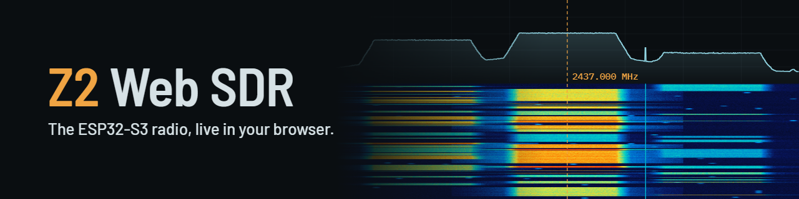
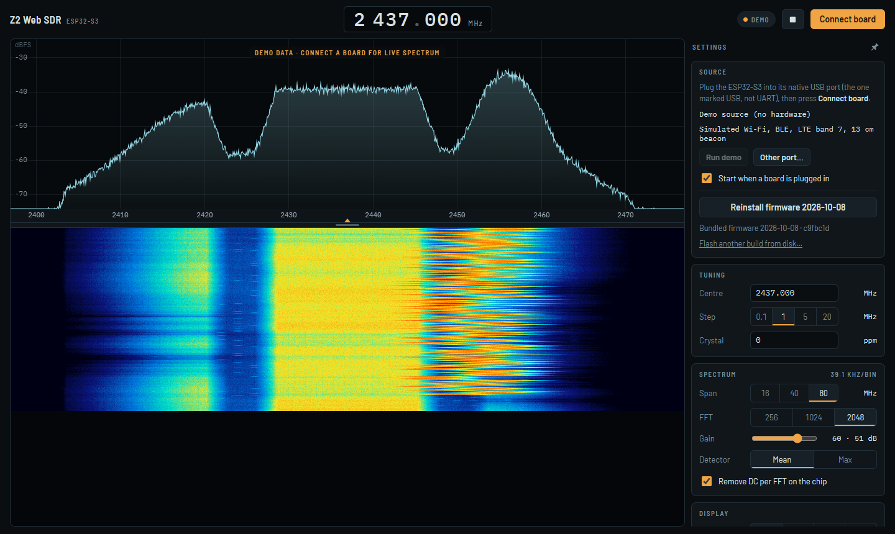

# Z2 Web SDR

**Open it: [z2labs.github.io/z2-web-sdr](https://z2labs.github.io/z2-web-sdr/)** (Chrome or Edge), or download [`index.html`](index.html) and open it from disk.

A browser front end for the ESP32-S3 software-defined radio (ESP-SDR firmware), the Ionos SDR and the **HackRF One**. One HTML file: open it in Chrome or Edge, plug the board in, press **Connect board** (or **HackRF**). No install, no server.

- Live on-chip spectrum of 16, 40 or 80 MHz with 256 to 2048 bins, about 270 spectra per second over the plain USB cable.
- Waterfall with every spectrum as a row, drawn on the GPU (WebGL2, 2D canvas fallback). History stays at its frequency when you pan, zoom or retune.
- Touch-first: drag to tune, pinch or Ctrl + scroll to zoom, tap for a marker, per-digit frequency readout. Works on phones and desktops.
- Firmware install over the same USB cable (the ESP32-S3 ROM bootloader, like esptool). The current ESP-SDR firmware is built into the page.
- Auto range, peak hold, marker to peak, spectrum export to CSV (snapshot, average or max over N spectra, interval log), debug report.
- Starts by itself when a board is plugged in (after the first permission), keeps the screen on.

The ESP32-S3 receives 2204–2804 MHz, the HackRF One 1–6000 MHz.



## Use

1. Open `index.html` (from this repository, a release, or the hosted page) in **Chrome or Edge** on Windows, macOS or Linux (Android too for the HackRF). Web Serial and WebUSB are not available in Firefox, Safari or on iOS.
2. Connect the ESP32-S3 by its **native USB port** (on a DevKit the connector marked USB, not UART).
3. Press **Connect board** and pick the port. If the board has no ESP-SDR firmware, or an older one, the orange **Install firmware** button installs the bundled build (tap twice; about 15 s).

The page works from a local file (`file://`) or any https address. Settings are kept in the browser.

## HackRF One

Press **HackRF** in the Source panel (WebUSB; Chrome or Edge on Windows, macOS, Linux and Android). A HackRF that was allowed once is opened again by itself when it is plugged in.

- **Live** (span 2, 4, 10 or 20 MHz): the int8 I/Q stream at that sample rate, FFT in the page (1024–4096 points, up to 250 spectra per second, each the mean or max of up to 8 FFTs). The baseband filter is set as libhackrf does (widest filter up to 0.75 × the rate). *Remove the DC spike* subtracts each FFT block's mean, which takes out the LO leak at the centre.
- **Sweep** (span 100 MHz, 500 MHz, 2 GHz or 6 GHz): the firmware's sweep mode, as `hackrf_sweep` uses it: 20 MS/s, 15 MHz filter, 20 MHz interleaved steps with a 7.5 MHz offset, one 16 KB block per tuning; of each block's FFT the page keeps F…F+5 MHz and F+10…F+15 MHz. One waterfall row per sweep. Needs firmware 2017.02.1 or newer (USB API 1.04).
- LNA (0–40 dB, 8 dB steps), VGA (0–62 dB, 2 dB steps), RF amplifier, antenna port power. On disconnect the page switches RX, the amplifier and the antenna power off.

Drivers: none on Windows (the HackRF firmware asks Windows for WinUSB by itself; if Zadig moved it to libusbK or libusb0, set it back to WinUSB), macOS and Android. **Linux** needs a udev rule, and the kernel's `hackrf` driver must not hold the device (libhackrf detaches it, a browser cannot). The page shows these commands when it cannot open the HackRF:

```
echo 'SUBSYSTEM=="usb", ATTR{idVendor}=="1d50", ATTR{idProduct}=="6089|604b|cc15", MODE="0666", TAG+="uaccess"' | sudo tee /etc/udev/rules.d/60-z2-hackrf.rules
echo 'blacklist hackrf' | sudo tee /etc/modprobe.d/z2-hackrf.conf
sudo modprobe -r hackrf; sudo udevadm control --reload-rules && sudo udevadm trigger
```

then unplug and replug the HackRF. Chromium from the Snap store (the Ubuntu default) also needs `sudo snap connect chromium:raw-usb` and a browser restart; Google Chrome from the .deb does not.

The vendor requests are those of libhackrf (`greatscottgadgets/hackrf`, `host/libhackrf/src/hackrf.c`), the sweep block format that of the firmware (`firmware/hackrf_usb/usb_api_sweep.c`). Code: `src/hackrf.js`. Tests: `node test/hackrf.mjs` (filter, sweep range, block parser) and `python test/hackrf.py` against the emulated HackRF `test/mock_hackrf.js`.

## Ionos SDR

The page also drives the **Ionos SDR** (`ionos-sdr-mini`: EFR32FG23 radio board on an ESP32-S3 carrier, 430–440 MHz). Plug its native USB port in and press **Connect board**: the page recognises the Ionos block stream before any ESP-SDR probe, switches the band, span and step controls to the Ionos profile (no gain slider, no firmware installer), and shows

- **I/Q mode** (span 50 / 100 / 200 kHz): the int16 stream at 50, 100 or 200 ksps (`R` command; the fastest rate comes from the board's `decim_list`, older firmware stops at 50 ksps) is FFT'd in the browser (256–2048 points, Nuttall window, dBFS), with the receiver's RSSI in the status line;
- **scan mode** (spans above the I/Q rate, 1 … 10 MHz): the FG23 RSSI sweep (`W` command, up to 1016 bins, absolute dBm).

The port is opened once and handed over after detection, with DTR on and RTS off for the whole session: on firmware that uses the ESP32-S3 USB-Serial/JTAG, RTS asserted while DTR is low resets the chip. Current firmware (TinyUSB CDC on the USB-OTG peripheral) does not reset, but the page keeps the same rule.

Protocol: `docs/ionos-usb-protocol.md` in [ionos-sdr/ionos-sdr](https://github.com/ionos-sdr/ionos-sdr) (1040-byte `IQB2` / `SPC1` / `MSG1` blocks, text commands `FH`, `R`, `W`, `CAP?`, `VER?`). Test: `python test/ionos.py` against the emulated board `test/mock_ionos.js`.

## Build

`index.html` is generated; edit the files in `src/`.

```
python tools/build.py [fw_dir]   # inline src/flasher.js and src/hackrf.js, embed the firmware bundle
python tools/build.py --check    # CI: index.html must match src/ and fw/
```

`fw/` holds the firmware bundle in the layout SDR++ ESP ships (`flash_args`, `bootloader/`, `partition_table/`, `esp_sdr.bin`, `version.json`). To update the firmware, replace `fw/` with a new bundle and rebuild.

## Tests

The tests run in headless Chromium against an emulated board (`test/mock_board.js`: the ESP-SDR text protocol and SPC1 frames, and the ROM bootloader with the USB Serial/JTAG reset logic).

```
pip install playwright && python -m playwright install chromium
python test/gen.py && node test/run.mjs && node test/md5test.mjs && node test/hackrf.mjs
python test/live.py && python test/flash.py && python test/reflash.py && python test/features.py && python test/wrongport.py && python test/rack.py && python test/ionos.py && python test/hackrf.py
```

`tools/render_images.py` renders `docs/banner.png`, `docs/social.png` (the repository's social preview) and `docs/screenshot.png` from `docs/banner.html` and the page, with headless Chrome or Edge.

`tools/capture_spec.py` records a raw SPEC stream from a real board (pyserial), `tools/check_capture.py` walks it the way the page does.

## Related

- Firmware: [zodoczi/esp-sdr](https://github.com/zodoczi/esp-sdr) (fork of [ESPARGOS/esp-sdr](https://github.com/ESPARGOS/esp-sdr)). The firmware binaries in `fw/` and embedded in `index.html` are built from it; its source is available there under GPLv3.
- Desktop and Android app: SDR++ ESP, [z2labs/SDRPlusPlus](https://github.com/z2labs/SDRPlusPlus), with the source module [z2labs/sdrpp-esp-sdr-source](https://github.com/z2labs/sdrpp-esp-sdr-source). The serial protocol client and the flasher in this page are ports of that module.

## License

GPLv3, see `LICENSE`.
